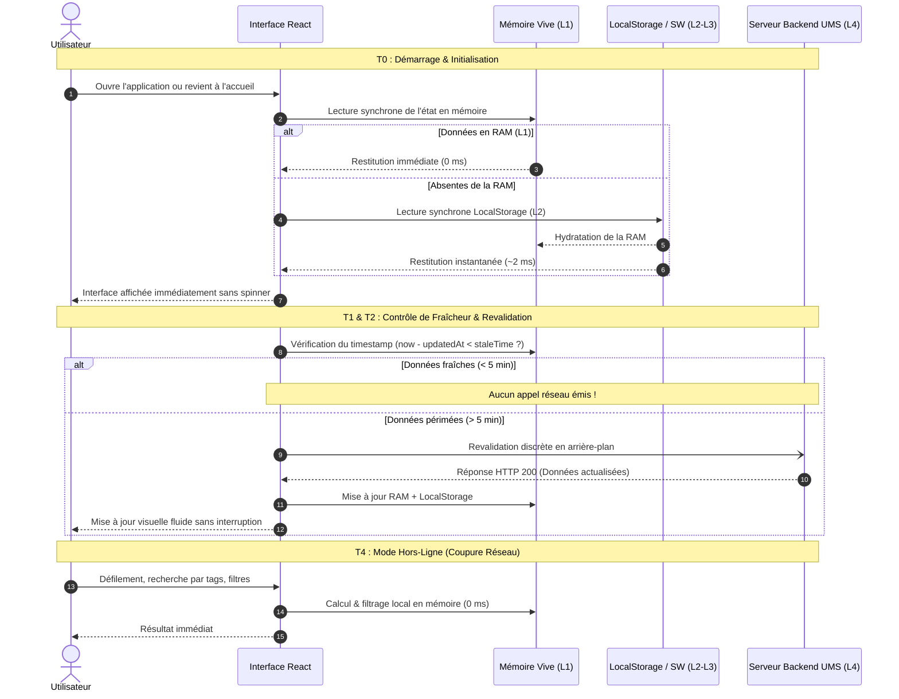

# Architecture du Cache, de la Mémoire Vive et du Mode Hors-Ligne (UMS)

> Ce document synthétise de manière ordonnée et chronologique le cycle de fonctionnement du système de cache multi-niveaux, de la mémoire vive frontend et de la résilience hors-ligne de **The Universal Media Stack**.

---

## 1. Principes Directeurs & Objectifs de Performance

1. **Affichage Instantané (0 ms) :** Lors du retour à l'accueil ou de la navigation inter-onglets, l'interface doit s'afficher immédiatement à partir de la mémoire vive sans afficher de spinner ni bloquer le thread UI.
2. **Économie Drastique des Requêtes Réseau :** Ne jamais solliciter le serveur si les données locales sont encore fraîches (seuil de fraîcheur configurable, 5 minutes par défaut).
3. **Revalidation en Arrière-Plan Non-Bloquante :** Si une revalidation est requise, elle se déroule en arrière-plan sans perturber la fluidité ni écraser brutalement les éléments affichés.
4. **Exclusion Stricte des Fichiers Vidéos :** Les flux et conteneurs vidéo (`.mkv`, `.mp4`, flux HLS/DASH) sont strictement exclus du stockage persistant local (IndexedDB/CacheStorage) afin de préserver l'espace disque du client. Seuls les métadonnées (titres, résumés, tags, EAV, positions de lecture) et les visuels (posters, bannières, logos) sont persistés.
5. **Autonomie Hors-Ligne :** L'application reste pleinement explorable et navigable même en l'absence totale de connexion au serveur UMS.

---

## 2. Architecture Tri-Niveaux du Cache Client

```
+--------------------------------------------------------------------------------+
| NIVEAU 1 : Mémoire Vive JS (RAM / Variables Modules / Stores React)   [0 ms]   |
|   - cachedCategories (TaxonomyCategory[])                                      |
|   - memoryDataCache (Map<string, CacheEntry<any>>)                             |
|   - activeTabState (Filtres, requêtes de recherche, offsets de défilement)      |
+--------------------------------------------------------------------------------+
                                       |
                                       v
+--------------------------------------------------------------------------------+
| NIVEAU 2 : Stockage Persistant Local (Web Storage / LocalStorage)     [1-5 ms] |
|   - Clés `ums_cache_data_*` avec timestamps et payload JSON                    |
|   - Identifiants de session et préférences utilisateur                         |
+--------------------------------------------------------------------------------+
                                       |
                                       v
+--------------------------------------------------------------------------------+
| NIVEAU 3 : Service Worker & CacheStorage PWA                         [5-20 ms] |
|   - `ums-v1-runtime` : Bundles JS, CSS, fonts, coquille applicative            |
|   - `ums-v1-images`  : Affiches, fanarts, logos mis en cache immutable         |
+--------------------------------------------------------------------------------+
                                       |
                                       v
+--------------------------------------------------------------------------------+
| NIVEAU 4 : Passerelle API & Proxy Backend UMS                       [> 20 ms]  |
|   - Headers `Cache-Control: public, max-age=31536000, immutable`               |
|   - Proxy transparent des images TMDb avec `Access-Control-Allow-Origin: *`    |
+--------------------------------------------------------------------------------+
```

---

## 3. Déroulement Chronologique par Étapes Temporelles

Voici la séquence chronologique exacte ordonnée dans le temps, depuis l'ouverture du site jusqu'au mode hors-ligne et à la réconciliation.



---

### Phase T0 : Démarrage du Client & Enregistrement (0 à 10 ms)
- **Initialisation du Service Worker :** Le script [`sw.js`](file:///var/home/tele/Documents/theuniversalmediastack/frontend/public/sw.js) prend le contrôle du cycle de vie du navigateur.
- **Enregistrement des Caches :** Création des magasins `ums-v1-runtime` (app shell) et `ums-v1-images` (artworks).
- **Pré-chargement des Variables Globales :** Les modules singletons [`pwaDataCache.ts`](file:///var/home/tele/Documents/theuniversalmediastack/frontend/src/services/pwaDataCache.ts) et [`authStore.ts`](file:///var/home/tele/Documents/theuniversalmediastack/frontend/src/services/authStore.ts) préparent les structures de données en mémoire vive.

---

### Phase T1 : Premier Chargement à Froid (Cold Start)
- **Consultation L1 (RAM) :** La mémoire vive est vide.
- **Consultation L2 (LocalStorage) :** Le cache persistant fournit les dernières catégories et médias connus si disponibles.
- **Requête Réseau Initiale :** Si aucun cache n'existe, l'API backend est interrogée (`/api/ui/taxonomy`).
- **Enregistrement Tripartite :** La réponse est instantanément inscrite :
  1. En **Mémoire Vive (RAM)** avec horodatage `Date.now()`.
  2. Dans le **LocalStorage** sous la clé `ums_cache_data_taxonomy_categories`.
  3. Dans le **CacheStorage** du Service Worker pour les ressources statiques.
- **Pré-chargement non-bloquant des Images :** Le module [`pwaImageCache.ts`](file:///var/home/tele/Documents/theuniversalmediastack/frontend/src/services/pwaImageCache.ts) utilise des instances natives `new Image()` par lots de 6 éléments pour pré-chauffer les affiches dans le cache du navigateur sans engorger les connexions réseau.

---

### Phase T2 : Navigation Standard & Retour Immédiat à l'Accueil (0 ms)
- **Scénario :** L'utilisateur consulte la fiche détaillée d'un film, la TV en direct ou les réglages, puis clique sur le bouton retour ou sur le logo d'accueil.
- **Lecture Synchrone Prioritaire :** 
  ```typescript
  // frontend/src/app/index.tsx
  const [categories, setCategories] = useState<TaxonomyCategory[]>(() => {
    if (cachedCategories && cachedCategories.length > 0) return cachedCategories;
    return getCachedData<TaxonomyCategory[]>('taxonomy_categories') || [];
  });
  ```
- **Rendu sans Spinner (0 ms) :** `loading` est positionné à `false` immédiatement car les données sont déjà en mémoire.
- **Restauration Immédiate de la Position de Scroll :** La position verticale précédente (`sessionStorage.getItem('ums_home_scroll_y')`) est réinjectée de façon synchrone dans le composant `ScrollView` dès le premier tick de rendu.
- **Élimination de la Cascade de Requêtes :** Les composants [`CategorySection`](file:///var/home/tele/Documents/theuniversalmediastack/frontend/src/components/CategorySection.tsx) et [`TagCard`](file:///var/home/tele/Documents/theuniversalmediastack/frontend/src/components/TagCard.tsx) récupèrent instantanément leurs listes de médias à partir de leur clé de cache dédiée (`taxonomy_medias_${catId}_${tagSlug}_limit_12`).

---

### Phase T3 : Revalidation Différée en Arrière-Plan (Stale-While-Revalidate Intelligent)
- **Contrôle du Seuil de Fraîcheur :**
  ```typescript
  const isFresh = (now - item.timestamp) < (staleTime ?? 300_000); // 5 minutes par défaut
  ```
- **Si les données sont fraîches (< 5 min) :** L'appel réseau est purement et simplement ignoré. Le client fonctionne en autonomie complète, préservant la bande passante et la batterie du client.
- **Si les données sont périmées (> 5 min) :**
  1. L'interface affiche toujours immédiatement les données en mémoire vive (zéro attente pour l'utilisateur).
  2. Une requête HTTP d'arrière-plan est lancée en tâche asynchrone non-bloquante.
  3. À la réception de la réponse, le cache mémoire et persistant est mis à jour.
  4. Si les données reçues comportent des modifications réelles, le composant React met à jour son état de façon imperceptible.

---

### Phase T4 : Déconnexion Réseau & Mode Hors-Ligne Total
- **Comportement en l'absence de réseau :**
  - Toutes les navigations vers l'accueil, les catégories, les tags et les fiches déjà consultées s'exécutent à 100% depuis la mémoire et le cache local.
  - La recherche instantanée dans les tags et les médias s'appuie sur le filtrage en mémoire vive O(1).
  - Aucune erreur fatale de type `NetworkError` n'est levée ; les fonctions de synchronisation interceptent l'état `navigator.onLine === false` ou le rejet du `fetch` et retournent le contenu mis en cache.
  - Le Service Worker intercepte les requêtes de navigation et sert la coquille PWA mise en cache (`Cache-First` pour les assets).

---

### Phase T5 : Reconnexion & Réconciliation
- **Événement `online` du Navigateur :** L'écouteur global détecte le retour d'une connexion internet valide.
- **Revalidation Ciblée :** Les prochaines navigations ou les gestes de tirage vers le bas (*Pull-to-Refresh*) réactivent le flag `forceRefresh: true`.
- **Invalidation Fine :** Si une modification est effectuée côté client (ex: ajout d'un média à la liste des favoris ou mise à jour de la progression de lecture), le cache ciblé est invalidé localement sans vider l'intégralité de la médiathèque.

---

## 4. Matrice des Données Mises en Cache vs Données Exclues

| Type de Donnée | Niveau de Cache | Persistance Disque | Exclusion / Justification |
| :--- | :---: | :---: | :--- |
| **Arborescence & Catégories (Taxonomy)** | RAM + LocalStorage | Oui | Donnée structurelle légère (< 50 Ko) |
| **Métadonnées des Médias & Tags** | RAM + LocalStorage | Oui | Requis pour l'affichage instantané 0 ms |
| **Affiches, Fanarts & Logos** | Service Worker CacheStorage | Oui | Fichiers d'artworks légers (WebP / JPEG optimisés) |
| **Progression de Lecture (Watch Progress)** | RAM + LocalStorage + API | Oui | Permet la reprise de lecture immédiate |
| **États des Onglets & Position Scroll** | RAM + SessionStorage | Temporaire | Réinitialisé à la fermeture de l'onglet |
| **Flux Vidéos (`.mkv`, `.mp4`, HLS, DASH)** | **AUCUN** | **NON (Exclu)** | **Trop volumineux (Go). Risque de saturation disque immédiate.** |

---

## 5. Résolution des Problèmes Réseau & CORS pour les Artworks

### Défi Initial
Les affiches de films pointant vers TMDb généraient des erreurs de type :
```
Access to fetch at 'https://image.tmdb.org/t/p/original/...' (redirected from '/api/media/:id/poster') 
has been blocked by CORS policy: No 'Access-Control-Allow-Origin' header is present on the requested resource.
```
Ce problème provenait d'une redirection HTTP 302 vers le CDN de TMDb, bloquée par la politique CORS des navigateurs lors de pré-chargements `fetch(..., { mode: 'cors' })`.

### Solution Déployée
1. **Proxy Transparent Côté API ([`mediaArtworks.ts`](file:///var/home/tele/Documents/theuniversalmediastack/backend/src/routes/mediaArtworks.ts)) :**
   - Le backend UMS télécharge lui-même le flux binaire de TMDb côté serveur.
   - Il le sert au frontend avec un code HTTP 200, les en-têtes `Access-Control-Allow-Origin: *` et un en-tête d'immutabilité :
     ```http
     HTTP/1.1 200 OK
     Content-Type: image/jpeg
     Access-Control-Allow-Origin: *
     Cache-Control: public, max-age=31536000, immutable
     ```
2. **Pré-chargement Natif HTML ([`pwaImageCache.ts`](file:///var/home/tele/Documents/theuniversalmediastack/frontend/src/services/pwaImageCache.ts)) :**
   - Remplacement des requêtes `fetch()` manuelles par `new Image().src = url`.
   - Utilisation d'un ordonnanceur de concurrence limitant à 6 requêtes simultanées pour ne pas saturer le pool de sockets du navigateur.
3. **Tolérance Opaque dans le Service Worker ([`sw.js`](file:///var/home/tele/Documents/theuniversalmediastack/frontend/public/sw.js)) :**
   - Les réponses d'artworks de type `opaque` ou `200` sont enregistrées sans déclencher d'erreur 404 artificielle.

---

## 6. Synthèse des Garanties

1. **Vitesse :** Revenir à l'accueil prend **0 ms** de calcul réseau. L'interface s'affiche au premier frame d'animation (16 ms).
2. **Légèreté :** 0 octet de vidéo mis en cache disque persistant, garantissant une empreinte de stockage saine (< 15 Mo pour l'ensemble des métadonnées).
3. **Discrétion :** Aucune mise à jour visuelle saccadée ni rechargement intempestif d'éléments visibles.
4. **Hors-ligne :** Même dans un train ou en avion sans réseau, l'utilisateur a accès à sa médiathèque complète, à ses filtres et à ses informations d'épisodes.
