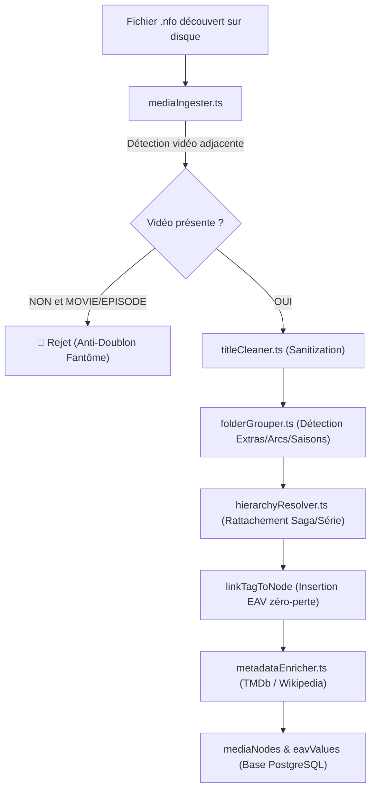

# Mémoire des Actions & Guide Opérationnel pour Agents IA Autonomes (UMS)

> **Document de référence impératif pour tout Agent IA intervenant sur le projet The Universal Media Stack (Coolove / UMS).**
> Ce guide rassemble toutes les commandes réelles, les pièges d'environnement à éviter, les protocoles d'outils et les règles architecturales fondamentales pour réussir chaque intervention dès le premier essai, sans perte de temps ni tâtonnement.

---

## 1. Règle d'Or Absolue : Algorithmes et Systèmes vs Données

```
+-----------------------------------------------------------------------------------------+
|                                  LOI FONDAMENTALE                                       |
|  NE JAMAIS MANIPULER OU CORRIGER LES DONNÉES MANUELLEMENT EN BASE OU SUR DISQUE !       |
|                                                                                         |
|  La médiathèque compte des dizaines de milliers de fichiers répartis sur des disques    |
|  internes et externes (NTFS, LowNTFS-3g, ext4, clés USB, réseaux locaux).              |
|                                                                                         |
|  -> Si une anomalie apparaît (titre corrompu, jaquette manquante, réalisateur absent,   |
|     doublon fantôme, mauvaise saison, tag manquant) :                                   |
|     VOUS DEVEZ AMÉLIORER L'ALGORITHME DU SYSTÈME (Watcher, Parser NFO, TitleCleaner,    |
|     FolderGrouper, HierarchyRepair, MediaReconciler, MetadataEnricher, EAV).            |
|                                                                                         |
|  Tout correctif doit être idempotent, universel et automatisé pour l'ensemble du stack. |
+-----------------------------------------------------------------------------------------+
```

---

## 2. Stack Technologique & Environnement d'Exécution

### 2.1. Système d'Exploitation & Conteneurisation
- **OS Hôte :** Linux (Fedora Silverblue / Kinoite / Atomic avec rpm-ostree et `lowntfs-3g`).
- **Moteur de conteneurs :** **`podman` EXCLUSIVEMENT** (rootless).
  - 🛑 **Ne JAMAIS utiliser `docker` ou `docker-compose`** : le démon Docker n'est pas actif dans cet environnement et générera des erreurs d'accès socket.
  - ✅ **Toujours utiliser `podman` et `podman compose`** (ou manipuler directement les conteneurs existants via `podman exec`, `podman restart`, etc.).

### 2.2. Cartographie des Conteneurs et Ports Actifs
| Conteneur | Image / Rôle | Port Interne | Port Externe | Description |
| :--- | :--- | :---: | :---: | :--- |
| **`ums_gateway`** | `caddy:2-alpine` | `80`, `443` | `8080` | Passerelle Reverse Proxy unifiée, streaming Zéro-CORS & routes `/api` |
| **`ums_postgres`** | `postgis/postgis:16-3.4-alpine` | `5432` | `5432` | Base PostgreSQL 16 avec extensions `pg_trgm`, `fuzzystrmatch`, `postgis` |
| **`ums_api`** | `universal-media-stack-backend` | `3000` | `3000` | Serveur API Hono + Drizzle ORM (`npm run dev` via `tsx watch src/index.ts`) |
| **Frontend Web** | Expo / React Native Web | `8081` | `8081` | Tourne directement sur l'hôte via `npm exec expo start -c --port 8081` |

### 2.3. Montages de Stockage & Gestion In-Place (Zero-Copy)
Les médias sont montés *in-place* et ne doivent **jamais** être déplacés, renommés ou supprimés du disque physique :
- `/var/home/tele/Vidéos/drive` : Médiathèque principale.
- `/run/media/tele/My Passport` : Disque externe USB (montage lowntfs-3g).
- `/run/media/tele/gudbug` : Disque externe partagé (films et séries).
- `/home/tele/Documents/theuniversalmediastack/backend` : Monté dans `ums_api` sur `/app`.
- `/home/tele/Documents/theuniversalmediastack/media` : Dossier tampon monté sur `/media`.

---

## 3. Boîte à Outils : Commandes de Développement & Validation

### 3.1. Gestion des Conteneurs avec Podman
```bash
# Vérifier l'état de tous les conteneurs
podman ps

# Consulter les logs du backend en temps réel
podman logs -f --tail 50 ums_api

# Redémarrer le conteneur API après une modification critique
podman restart ums_api

# Inspection directe de la base de données PostgreSQL
podman exec ums_postgres psql -U ums -d ums_db -c "SELECT id, title, node_type, poster_path FROM media_nodes WHERE title ILIKE '%tarantino%';"
```

### 3.2. Compilation & Tests TypeScript
Le code backend est monté dans `/app` sous `tsx watch`, mais la validation de type et les tests doivent être exécutés :
```bash
# Compiler le backend TypeScript (vérification stricte de typage)
npm run build --prefix backend

# Exécuter l'ensemble des suites de tests automatisées (100% indispensables)
npm run test:profiles --prefix backend   # 25 profils de parsing et heuristiques
npm run test:lang --prefix backend       # Moteur de sélection et fallback audio/sous-titres
npm run test:security --prefix backend   # PBAC, ABAC, dossiers restreints et isolation
npm run test:social --prefix backend     # Favoris, amis, séances synchronisées, avis
```

### 3.3. Commandes `curl` pour Tester les Endpoints en Conditions Réelles

L'authentification standard s'effectue via l'en-tête `x-user-id` ou le jeton Bearer. L'administrateur par défaut a pour UUID `f0de0b93-d77f-4600-9962-54cc1441189c`.

```bash
# 1. Vérifier la fiche détaillée d'un média et ses métadonnées EAV
curl -s -H "x-user-id: f0de0b93-d77f-4600-9962-54cc1441189c" \
  "http://localhost:8080/api/media/<MEDIA_UUID>" | jq .media

# 2. Vérifier les films enfants d'une saga/collection avec leurs réalisateurs
curl -s -H "x-user-id: f0de0b93-d77f-4600-9962-54cc1441189c" \
  "http://localhost:8080/api/media/<COLLECTION_UUID>" | jq '.children[] | {title, releaseYear, director, posterPath}'

# 3. Tester l'extraction WebVTT de sous-titres (supporte HEAD et GET avec cache disque L2)
curl -i -s "http://localhost:8080/api/media/<MEDIA_UUID>/subtitles?trackIndex=4" | head -n 25

# 4. Vérifier les rails de la page d'accueil (Server-Driven UI)
curl -s -H "x-user-id: f0de0b93-d77f-4600-9962-54cc1441189c" \
  "http://localhost:8080/api/ui/layout?page=HOME" | jq '.rails[] | {title, count: (.items | length), sample: [.items[0..2]?.title]}'

# 5. Déclencher un scan complet de réconciliation et de réparation algorithmique
curl -X POST -H "x-user-id: f0de0b93-d77f-4600-9962-54cc1441189c" \
  "http://localhost:8080/api/admin/repair/run" | jq .

# 6. Déclencher l'enrichissement externe TMDb / Wikipedia en tâche de fond
curl -X POST -H "x-user-id: f0de0b93-d77f-4600-9962-54cc1441189c" \
  "http://localhost:8080/api/admin/library/refresh" -d '{"limit": 50}' | jq .
```

---

## 4. Prévention des Pièges & Bonnes Pratiques d'Appels d'Outils

### 4.1. Le Piège des Nombres Flottants dans `view_file`
Les schémas JSON des outils ACP typent strictement les lignes en entiers (`type: "INTEGER"`).
- 🛑 **Erreur Fréquente :**
  ```json
  {
    "AbsolutePath": "/var/home/tele/.../file.ts",
    "StartLine": 380.0,
    "EndLine": 450.0
  }
  ```
  Le parseur de schéma rejettera l'appel avec une erreur de type `Invalid parameter type: expected integer, got float`.
- ✅ **Format Valide :**
  ```json
  {
    "AbsolutePath": "/var/home/tele/.../file.ts",
    "StartLine": 380,
    "EndLine": 450
  }
  ```

### 4.2. Manipulation Chirurgicale de Fichiers Source
Pour modifier des portions spécifiques de code sans réécrire des fichiers géants de plus de 800 lignes :
- Utiliser un script inline `node -e` via `run_command` avec `fs.readFileSync` et `fs.writeFileSync`.
- Remplacer un bloc textuel contextuel unique (incluant 2-3 lignes environnantes) pour éviter les correspondances accidentelles.
- Toujours relancer `npm run build --prefix backend` immédiatement après une édition pour confirmer que TypeScript ne remonte aucune erreur de syntaxe ou d'import.

---

## 5. Exploitation de l'IDE Zed & Environnement Développeur

L'utilisateur et le système utilisent l'IDE **Zed** (disponible sous `/app/extra/chrome` ou flatpak `dev.zed.Zed`).
Plusieurs serveurs de langage (LSP) tournent en continu en arrière-plan :
1. **`vtsls` (TypeScript Language Server) :** Lancé avec `--max-old-space-size=8192` pour assister l'analyse sémantique globale du projet.
2. **`tailwindcss-language-server` :** Gestion des styles utilitaires.
3. **`eslintServer` :** Linting en continu.

### Recommandations pour l'Agent IA :
- **Respect du Watcher :** Zed recharge instantanément les fichiers modifiés sur disque. Évitez les allers-retours désordonnés de fichiers temporaires dans le répertoire de travail.
- **Préservation des conventions TypeScript :** Préserver la compatibilité ES Modules (`import ... from './file.js'`) imposée par `"type": "module"` dans `backend/package.json`.
- **Règles des Hooks React :** Dans `frontend/`, ne jamais déclarer de hooks (`useState`, `useEffect`, `useMemo`) à l'intérieur de blocs conditionnels ou après des retours hâtifs (`if (...) return ...`).

---

## 6. Architecture des Modules Backend & Pipeline d'Ingestion



### Répartition des Responsabilités par Fichier :
- [`titleCleaner.ts`](file:///var/home/tele/Documents/theuniversalmediastack/backend/src/watcher/titleCleaner.ts) : Normalisation Unicode (NFKC), ligatures, chiffres romains, suppression des suffixes techniques (`1080p`, `x264`, `MULTi`, `MUTLI`, `BluRay`, `PopHD`), assainissement des résidus de crochets et préservation des titres français.
- [`folderGrouper.ts`](file:///var/home/tele/Documents/theuniversalmediastack/backend/src/watcher/folderGrouper.ts) : Classification des médias en `EXTRA` (`extras?`, `bonus`, `bd[\s._-]?menu`, `nc`, `creditless`, `trailer`, `sample`) et regroupement par saisons/arcs narratifs.
- [`mediaIngester.ts`](file:///var/home/tele/Documents/theuniversalmediastack/backend/src/watcher/mediaIngester.ts) : Porte d'entrée de l'indexation. Sanctuarisation contre les `.nfo` orphelins sans vidéo pour éliminer tout doublon fantôme.
- [`mediaReconciler.ts`](file:///var/home/tele/Documents/theuniversalmediastack/backend/src/watcher/mediaReconciler.ts) : Purge des médias orphelins et détection des déplacements physiques sur disque.
- [`hierarchyRepair.ts`](file:///var/home/tele/Documents/theuniversalmediastack/backend/src/watcher/hierarchyRepair.ts) : Réparation algorithmique de la taxonomie (requalification des faux épisodes en extras, correction des titres aberrants comme `]`, consolidation des sagas).
- [`metadataEnricher.ts`](file:///var/home/tele/Documents/theuniversalmediastack/backend/src/watcher/metadataEnricher.ts) : Moissonnage externe TMDb et Wikipedia, extraction des réalisateurs (`job === 'director'`), acteurs, scénaristes et jaquettes.
- [`mediaSubtitles.ts`](file:///var/home/tele/Documents/theuniversalmediastack/backend/src/routes/mediaSubtitles.ts) : Extraction résiliente WebVTT par FFmpeg (timeout 180s, buffer 20 Mo) avec double cache L1 (RAM) et L2 (Disque `/tmp/ums_subtitles_cache/`).
- [`FloatingBottomPlayer.tsx`](file:///var/home/tele/Documents/theuniversalmediastack/frontend/src/components/FloatingBottomPlayer.tsx) : Lecteur permanent autonome depliable/repliable, synchronisation multi-écrans, gestion des textTracks HTML5 WebVTT en mode plein écran et fenêtré, et neutralisation des clics intempestifs sur l'écran vidéo.
