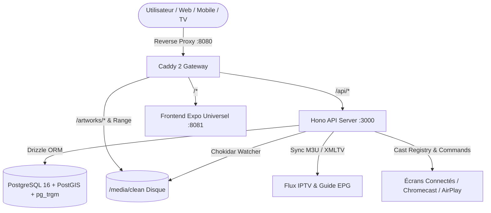

# 🛠 Documentation de la Stack Technique — The Universal Media Stack (v3.0)

Ce document décrit l'architecture technique exacte du projet, unifiée, modulaire et **Full-TypeScript** (Expo + Hono + Drizzle ORM + PostgreSQL 16 / PostGIS).

---

## 1. Vue d'Ensemble des Composants

---

## 2. Arborescence Modulaire (Règle SRP < 100 Lignes)

### Backend (`/backend/src`)
- `index.ts` : Serveur Hono principal, initialisation des migrations, watcher et routes.
- `db/` :
  - `connection.ts` : Connexion Drizzle / postgres-js pool.
  - `migrate.ts` & `migrateSecondary.ts` : DDL et création des extensions (`postgis`, `pg_trgm`, `unaccent`).
  - `runMigrations.ts` : Point d'entrée des migrations.
  - `schema/` :
    - `enums.ts` : Énumérations Postgres (`node_type`, `node_state`, `tag_zone`, `rail_type`).
    - `spatial.ts` : Type PostGIS `geometry(Point, 4326)`.
    - `nodes.ts` : Table `media_nodes` avec arbre récursif et index GIN trigramme.
    - `eav.ts` : Modèle EAV `eav_attributes`, `eav_values`, `node_eav_links`.
    - `rails.ts` : Table `ui_rails` pour le Server-Driven UI.
    - `users.ts` : Utilisateurs RBAC/ABAC et `watch_progress`.
    - `iptv.ts` : Sources IPTV `iptv_sources` et guide `epg_programs`.
- `seed/` :
  - `attributesData.ts` : Définition des 17 attributs Kyoo par défaut.
  - `railsData.ts` : Configuration des rails d'accueil par défaut.
  - `kyooPreset.ts` : Seeder idempotent `seedKyooPreset()`.
- `watcher/` :
  - `types.ts` & `slugify.ts` : Modèles et génération de slugs.
  - `nfoParser.ts` : Parsing XML `fast-xml-parser` avec extraction des flux et métadonnées.
  - `tagExtractor.ts` : Liaison EAV standard et capture dynamique (`custom_*`).
  - `mediaIngester.ts` : Insertion / mise à jour `media_nodes` et search vector.
  - `index.ts` : Surveillance continue Chokidar sur `MEDIA_CLEAN_ROOT`.
- `iptv/` :
  - `m3uParser.ts` : Parsing des directives `#EXTINF` des playlists IPTV.
  - `xmltvParser.ts` : Extraction du guide TV XMLTV.
  - `channelIngester.ts` : Création des chaînes dans `media_nodes` et tags.
- `cast/` :
  - `types.ts` : Types pour périphériques et commandes Cast.
  - `deviceRegistry.ts` : Registre in-memory avec TTL et file de commandes distantes.
- `middleware/` :
  - `access.ts` : Contrôle d'accès RBAC et filtrage de session.
- `routes/` :
  - `auth.ts` : Profils utilisateurs, code PIN et TV Quick-Connect.
  - `ui.ts` : Server-Driven UI layout d'accueil et taxonomie de tags.
  - `media.ts` : Fiche détaillée média et heartbeat de progression.
  - `search.ts` : Recherche instantanée par trigrammes (`< 10ms`).
  - `iptv.ts` : Chaînes TV, import de listes M3U et proxy HLS.
  - `cast.ts` : Découverte des écrans et envoi de commandes distantes.
  - `admin.ts` : Réordonnancement des rails et gestion des tags.

### Frontend (`/frontend/src`)
- `app/` :
  - `index.tsx` : Accueil cinématique avec rails Server-Driven UI.
  - `explore.tsx` : Exploration et filtrage multi-tags.
  - `live.tsx` : Chaînes TV en direct et guide EPG.
  - `media/[id].tsx` : Fiche média (4 zones de tags Kyoo).
  - `player/[id].tsx` : Lecteur vidéo avec bouton *Skip Intro* et fonction récepteur/émetteur Cast.
  - `admin.tsx` : Back-Office Server-Driven UI et import IPTV.
- `components/` :
  - `HeroSpotlight.tsx` & `.styles.ts` : Bannière plein écran cinématique.
  - `MediaCard.tsx` & `.styles.ts` : Carte média avec coins arrondis doux (`Radius.md`).
  - `MediaRail.tsx` : Rail horizontal défilant.
  - `TagPill.tsx` : Pilules de tags translucides et arrondies.
  - `SearchBar.tsx` & `.styles.ts` : Recherche instantanée auto-complétée.
  - `CastModal.tsx` & `.styles.ts` : Modale de sélection d'écrans (UMS Screens, Chromecast, AirPlay).
  - `CastControlBar.tsx` : Mini-télécommande flottante pour piloter la lecture distante.
  - `app-tabs.web.tsx` & `app-tabs.tsx` : Barre de navigation universelle.
- `constants/theme.ts` : Palette nuancée (fond `#0f172a`, cartes translucides, arrondis 12px à 24px et pilules 9999px).
- `services/api.ts` & `types.ts` : Client d'API typé.
- `services/castService.ts` : Service Cast (découverte, enregistrement, commandes).

---

## 3. Endpoints de l'API Hono

| Méthode | Route | Rôle |
| :--- | :--- | :--- |
| `GET` | `/api/health` | Vérification de statut du service |
| `GET` | `/api/ui/layout` | Rails d'accueil hydratés avec médias |
| `GET` | `/api/ui/tags` | Taxonomie et hiérarchie des tags |
| `GET` | `/api/media/:id` | Fiche détaillée avec tags groupés par zone |
| `POST` | `/api/media/:id/progress` | Enregistrement de la progression de lecture |
| `GET` | `/api/search?q=...` | Recherche floue par trigrammes `< 10ms` |
| `GET` | `/api/iptv/channels` | Chaînes TV actives avec EPG |
| `POST` | `/api/iptv/sources` | Ingestion d'une playlist M3U / XMLTV |
| `GET` | `/api/iptv/stream/:id/live.m3u8` | Proxy de flux HLS avec en-têtes CORS |
| `GET` | `/api/cast/devices` | Liste des écrans cibles actifs sur le réseau |
| `POST` | `/api/cast/register` | Enregistrement d'un écran en tant que récepteur Cast |
| `POST` | `/api/cast/heartbeat` | Mise à jour de la position et de l'état de lecture |
| `POST` | `/api/cast/command` | Envoi d'une commande distante (`LOAD`, `PLAY`, `PAUSE`, `SEEK`, `STOP`) |
| `GET` | `/api/cast/poll/:deviceId` | Récupération des commandes en attente pour un écran |
| `GET` | `/api/auth/profiles` | Liste des profils utilisateurs |
| `POST` | `/api/auth/login` | Connexion profil (code PIN) |
| `GET` | `/api/auth/quick-connect/code` | Code d'appairage TV à 6 chiffres |
| `GET` | `/api/admin/rails` | Liste des rails configurables |
| `POST` | `/api/admin/rails/reorder` | Sauvegarde de l'ordre des rails |
| `PATCH` | `/api/admin/tags/:id` | Modification de la zone ou couleur d'un tag |
