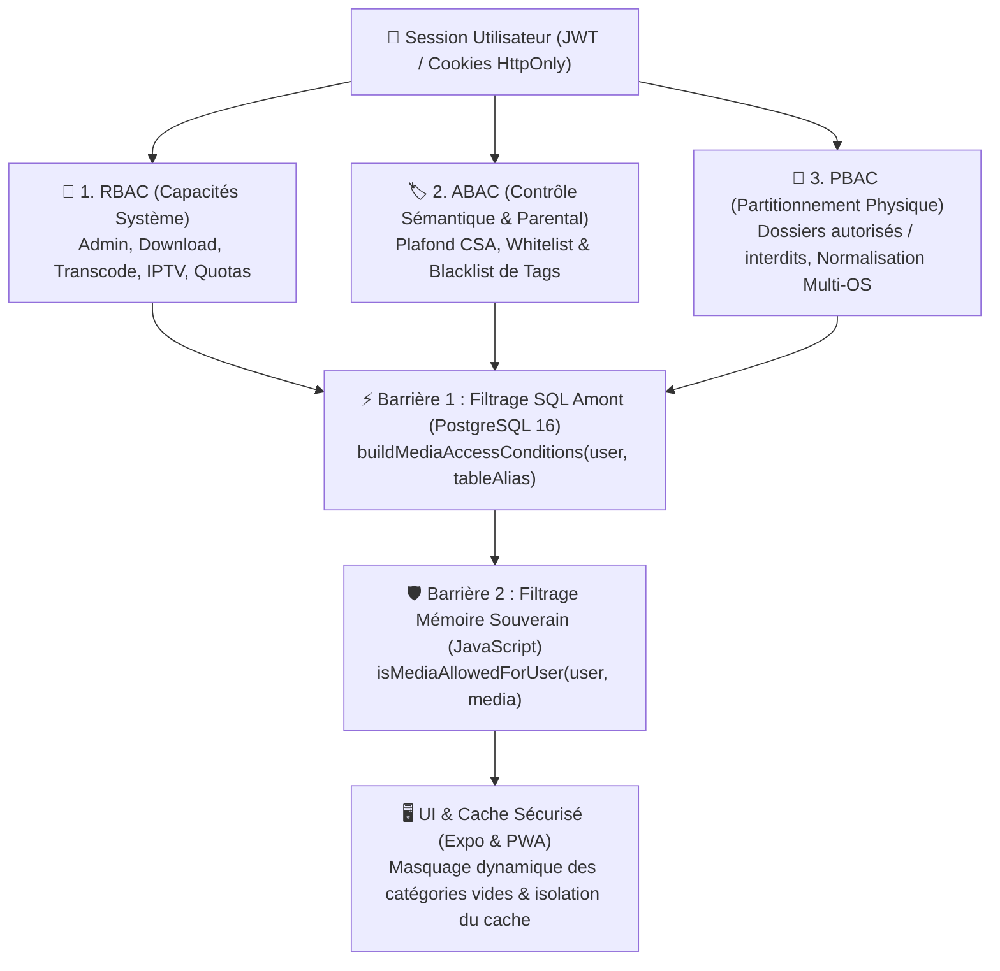
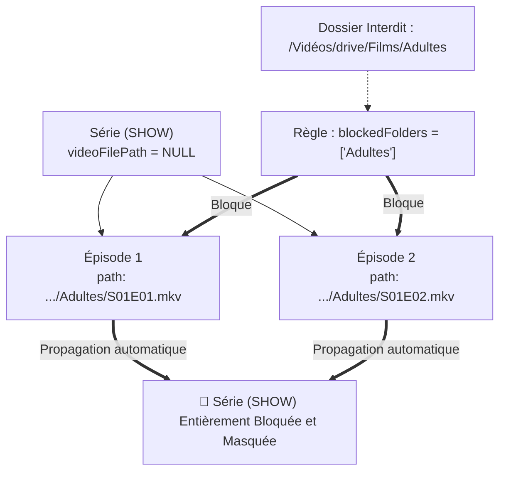

# Spécification Technique & Guide de Référence : Système de Droits et Contrôle d'Accès Utilisateurs

**The Universal Media Stack (UMS v3.0)**  
*Architecture de Sécurité Hybride : RBAC, ABAC & Partitionnement Physique PBAC (Path-Based Access Control)*  
*Environnement Hôte Optimisé : Bazzite / Fedora Atomic Desktop & Linux Standard*

---

## 1. Philosophie & Principes Fondamentaux de Sécurité

Dans une médiathèque moderne partagée, les profils d'utilisateurs (parents, enfants, adolescents, invités, colocataires) cohabitent sur les mêmes écrans (Smart TV du salon, tablettes, smartphones, ordinateurs portables). Le système de droits de **The Universal Media Stack** a été conçu pour satisfaire une règle absolue :

> ### 🛡️ La Loi d'Étanchéité Zéro-Fuite (*Zero-Leak Law*)
> Aucun média restreint (film, série, épisode, bonus ou chaîne IPTV) ne doit jamais fuiter dans les résultats de recherche, les rails d'accueil, les flux de streaming, les fiches de détail, les suggestions de médias suivants, les pistes de sous-titres, les caches locaux de navigateur ou la taxonomie de tags.

Pour atteindre ce niveau de rigueur sans sacrifier la fluidité ni imposer des temps de chargement perceptibles, l'architecture repose sur la convergence de trois paradigmes complémentaires :



---

## 2. Spécificités de l'Environnement Hôte Bazzite & Linux Immuable

**Bazzite** (basé sur Fedora Atomic Desktop / rpm-ostree) utilise une disposition de système de fichiers immuable où la racine `/` est en lecture seule et où les répertoires utilisateurs sont déportés :
- `/var/home` est le stockage réel physique des répertoires personnels.
- `/home` est un **lien symbolique symétrique** (`symlink`) pointant vers `/var/home`.
- Les disques durs externes ou volumes amovibles (ex: bibliothèques de films sur disques NTFS, Btrfs ou ext4) sont montés automatiquement sous `/run/media/tele/...` ou `/media/...`.

### Gestion des Divergences de Chemins (`normalizePathVariants`)
Si un administrateur configure une règle de restriction sur `/home/tele/Vidéos/drive/Films` mais que le watcher a indexé le fichier sous `/var/home/tele/Vidéos/drive/Films` (ou inversement), une comparaison naïve de chaînes échoue.

Le moteur [`backend/src/auth/mediaAccess.ts`](file:///var/home/tele/Documents/theuniversalmediastack/backend/src/auth/mediaAccess.ts) génère de façon déterministe l'ensemble des alias symétriques pour chaque chemin :
```typescript
export function normalizePathVariants(inputPath: string): string[] {
  // 1. Normalisation Unicode NFC (gestion des caractères accentués 'Vidéos', etc.)
  // 2. Déduplication des slashes et suppression du trailing slash
  // 3. Dérivation bidirectionnelle /home <-> /var/home
  // 4. Gestion des montages disques /run/media <-> /media
}
```
Ce mécanisme garantit une étanchéité parfaite sous Bazzite, Fedora Silverblue, SteamOS, Debian ou Ubuntu sans configuration manuelle de l'utilisateur.

---

## 3. Matrice des Rôles & Capacités Système (RBAC)

Chaque utilisateur dispose d'attributs fonctionnels enregistrés dans la table PostgreSQL `users` :

| Propriété Drizzle | Type SQL | Rôle & Comportement Système |
| :--- | :--- | :--- |
| `isAdmin` | `boolean` | **Super-Administrateur** : Accès sans restriction au Back-Office (`/admin`), aux réglages de layout, au gestionnaire d'invitations, aux scans de disques, et exemption totale de tout filtre parental ou de dossier. |
| `profileRole` | `text` | Profil type (`ADMIN`, `STANDARD`, `KIDS`, `GUEST`). Permet d'adapter l'ergonomie par défaut du client. |
| `canDownload` | `boolean` | **Téléchargement Hors-ligne** : Autorise la génération d'en-têtes HTTP `X-Accel-Redirect` vers Caddy pour récupérer les fichiers originaux. Si faux, le bouton de téléchargement est totalement masqué et l'API bloque l'appel. |
| `canTranscode` | `boolean` | **Transcodage Matériel** : Autorise l'allocation de workers GPU sur le conteneur `transcoder`. Si désactivé, le lecteur force le Direct Play pur. |
| `canWatchIptv` | `boolean` | **Télévision en Direct** : Active ou désactive l'accès aux chaînes IPTV (`LIVE_CHANNEL`) et au guide des programmes EPG. Si faux, l'onglet TV et les flux `.m3u8` sont interdits (code 403). |
| `isIncognito` | `boolean` | **Navigation Confidentielle** : Désactive l'enregistrement de la progression de lecture dans `watch_progress` et l'affichage de présence dans les salons communautaires. |
| `maxConcurrentStreams` | `integer` | **Plafond de Sessions Simultanées** : Limite le nombre de flux vidéo actifs simultanément pour ce compte (ex: 2 écrans en simultané). |

---

## 4. Partitionnement Physique des Dossiers (PBAC - Path-Based Access Control)

Le partitionnement par dossiers permet d'isoler physiquement les répertoires du disque sans devoir créer plusieurs instances de bases de données ou plusieurs serveurs multimédias.

### 4.1. Règles Whitelist & Blacklist
Dans la configuration du profil (`/admin/users`) :
- **Whitelist (`allowedFolders: string[]`) :** Si la liste n'est pas vide, l'utilisateur est en **mode confinement strict**. Il ne peut voir, rechercher ou lire **QUE** les médias dont le chemin physique réside à l'intérieur de l'un des répertoires listés.
- **Blacklist (`blockedFolders: string[]`) :** Liste noire prioritaire. Tout média résidant sous un chemin correspondant est immédiatement banni, même si l'utilisateur dispose d'autres permissions par ailleurs.

### 4.2. Algorithme de Correspondance (`pathMatchesFolderRule`)
L'algorithme analyse si un chemin de fichier cible correspond à une règle de dossier :
1. **Racines absolues (`/home/tele/...`, `/var/home/...`, `/run/media/...`) :** Vérification stricte par préfixe après normalisation d'alias.
2. **Chemins partiels ou sous-dossiers (`Films/Adultes`, `Horreur`, `Privé`) :** Vérification avec respect des délimiteurs de segments (`/` ou début/fin de chaîne). Cela empêche par exemple la règle `Horreur` de bloquer accidentellement un dossier légitime nommé `HorreursDeLaGuerreDocumentaire`.

### 4.3. Exemption des Flux IPTV Virtuels (`LIVE_CHANNEL`)
Les chaînes de télévision en direct (`LIVE_CHANNEL`) sont des flux réseau virtuels issus de playlists M3U externes. Elles ne possèdent aucun fichier physique ni arborescence sur le système de fichiers local (`videoFilePath = NULL`).
Par conséquent :
- Le partitionnement par dossiers physiques (`allowedFolders` / `blockedFolders`) **ne s'applique pas** aux chaînes IPTV.
- Un utilisateur restreint par une liste blanche de dossiers disques (ex: accès exclusif à `/Vidéos/drive/libre`) peut accéder sans restriction à l'IPTV dès lors que sa capacité `canWatchIptv` est active.
- La protection des chaînes IPTV relève exclusivement du contrôle de capacité RBAC (`canWatchIptv`) et du contrôle sémantique ABAC (filtrage de tags `blockedTags` tels que `Adultes`, `+18`, `Horreur`).

---

## 5. Héritage Arborescent des Conteneurs (`SHOW`, `COLLECTION`, `SEASON`)

### Le Défi des Conteneurs Sans Fichier Direct
Dans un schéma de base de données multimédia :
- Un film (`MOVIE`) ou un épisode (`EPISODE`) possède un `videoFilePath` explicite (ex: `/home/tele/Vidéos/Films/Matrix.mkv`).
- En revanche, une saga (`COLLECTION`), une série (`SHOW`) ou une saison (`SEASON`) est une **entité logique abstraite** : son champ `videoFilePath` est `NULL` en base de données.

Une vérification naïve de sécurité autoriserait une série entière simplement parce que son champ direct est vide, créant une faille de sécurité majeure.

### La Solution d'Héritage Arborescent
Le moteur résout récursivement :
1. **`effectivePhysicalPath` :** Emprunt du chemin physique du premier fichier enfant disponible ou du fichier `.nfo` associé.
2. **`childPaths` :** Agrégation de l'ensemble des chemins physiques de tous les épisodes ou films enfants.



Si le dossier parent de la série est bloqué, ou si **l'ensemble de ses épisodes** appartient à un dossier interdit, le conteneur `SHOW` parent est **totalement inaccessible**. Il ne peut être ni affiché sur l'accueil, ni trouvé par la recherche, ni ouvert par son identifiant d'API.

---

## 6. Contrôle Parental & Attributs Sémantiques (ABAC)

En complément du partitionnement physique, le contrôle d'accès basé sur les attributs (ABAC) filtre les œuvres en fonction de leur contenu sémantique :

### 6.1. Plafond d'Âge CSA (`maxCsaAgeLimit`)
Les métadonnées NFO et les scrapers TMM/TMDb fournissent des classifications d'âge. UMS convertit les tags en valeurs d'âge numérique :
- `Tous Publics` / `G` $\rightarrow$ 0 an
- `CSA : -10` / `PG` $\rightarrow$ 10 ans
- `CSA : -12` / `PG-13` $\rightarrow$ 12 ans
- `CSA : -16` / `TV-MA` / `R` $\rightarrow$ 16 ans
- `CSA : -18` / `NC-17` $\rightarrow$ 18 ans

Si un compte profil Enfant a `maxCsaAgeLimit = 10`, le moteur injecte automatiquement une règle interdisant tout média étiqueté 12, 16 ou 18 ans.

### 6.2. Whitelist & Blacklist de Tags EAV
- `blockedTags` / `blockedValueIds` : Exclusion par mots-clés thématiques (ex: `Horreur`, `Gore`, `Armes`).
- `allowedTags` / `allowedValueIds` : Mode liste blanche stricte pour profils surveillés (ex: n'afficher que les médias ayant le tag `Animation` ou `Disney`).

---

## 7. Architecture de Sécurité à Double Barrière (Loi Zero-Leak)

Pour conjuguer **performances instantanées ($< 10\text{ ms}$)** et **herméticité absolue**, chaque requête traverse deux lignes de défense indépendantes :

### 7.1. Barrière 1 : Filtrage SQL Amont (`buildMediaAccessConditions`)
Situé dans [`backend/src/auth/mediaAccessSql.ts`](file:///var/home/tele/Documents/theuniversalmediastack/backend/src/auth/mediaAccessSql.ts), ce générateur traduit le profil utilisateur directement en clauses SQL PostgreSQL natives :
- Clauses `NOT (physicalPath ILIKE ...)` pour les dossiers bloqués.
- Clauses `(physicalPath ILIKE ... OR physicalPath ILIKE ...)` pour les dossiers autorisés.
- Exclusion des nœuds `LIVE_CHANNEL` si `canWatchIptv = false`.
- Clauses de tags sur `search_vector_text` et tables de jointures EAV.

*Avantages :* Élimine les médias interdits dès la source dans PostgreSQL, garantissant que les clauses `LIMIT`, `OFFSET` et les paginations des rails ne sont pas faussées par des éléments rejetés a posteriori.

### 7.2. Barrière 2 : Filtrage Mémoire Souverain (`isMediaAllowedForUser`)
Situé dans [`backend/src/auth/mediaAccess.ts`](file:///var/home/tele/Documents/theuniversalmediastack/backend/src/auth/mediaAccess.ts), ce validateur JavaScript ré-analyse en mémoire chaque nœud avant qu'il ne quitte le serveur Hono :
- Vérifie les chemins physiques réels et les alias Bazzite/Fedora.
- Inspecte les chemins des enfants agrégés (`childPaths`).
- Applique les filtres de tags et les seuils CSA.

*Avantages :* Protection inviolable de niveau applicatif contre d'éventuelles failles d'injection SQL, erreurs d'ORM ou ambiguïtés de jointures de conteneurs complexes.

---

## 8. Cartographie Complète des Points de Contrôle API

Toutes les routes exposées par le backend appliquent ce modèle de contrôle d'accès :

| Endpoint API | Fichier Source | Règle de Sécurité Appliquée |
| :--- | :--- | :--- |
| `GET /api/media/:id/stream` | [`mediaStream.ts`](file:///var/home/tele/Documents/theuniversalmediastack/backend/src/routes/mediaStream.ts) | Vérification `checkMediaAccess` : Renvoi immédiat de l'erreur HTTP 403 `FORBIDDEN` si le dossier ou les tags sont restreints. |
| `GET /api/media/:id` | [`media.ts`](file:///var/home/tele/Documents/theuniversalmediastack/backend/src/routes/media.ts) | Contrôle d'accès sur l'œuvre principale + **épuration stricte** des tableaux `childNodes` (épisodes) et `extras` (bonus). |
| `GET /api/media/:id/next` | [`mediaNext.ts`](file:///var/home/tele/Documents/theuniversalmediastack/backend/src/routes/mediaNext.ts) | L'enchaînement automatique (Netflix-style) filtre les candidats pour ne jamais basculer vers un épisode ou un film interdit. |
| `GET /api/media/:id/tracks` | [`mediaTracks.ts`](file:///var/home/tele/Documents/theuniversalmediastack/backend/src/routes/mediaTracks.ts) | Pistes audio et sous-titres protégées par `checkMediaAccess`. |
| `GET /api/search` | [`search.ts`](file:///var/home/tele/Documents/theuniversalmediastack/backend/src/routes/search.ts) | Exclusion SQL amont et filtre JS mémoire : zéro résultat interdit dans la barre de recherche globale. |
| `GET /api/ui/layout` | [`ui.ts`](file:///var/home/tele/Documents/theuniversalmediastack/backend/src/routes/ui.ts) | Résolution batch des chemins physiques et filtrage complet des rails d'accueil. |
| `GET /api/ui/taxonomy` | [`taxonomyRoutes.ts`](file:///var/home/tele/Documents/theuniversalmediastack/backend/src/routes/taxonomyRoutes.ts) | Agrégations SQL protégées par `accessConds` : les compteurs de tags ne révèlent pas l'existence de médias restreints. |
| `GET /api/ui/taxonomy/medias` | [`taxonomyRoutes.ts`](file:///var/home/tele/Documents/theuniversalmediastack/backend/src/routes/taxonomyRoutes.ts) | Double barrière SQL/JS appliquée à chaque rail de tag et grille de catégorie. |
| `GET /api/media/:id` | [`media.ts`](file:///var/home/tele/Documents/theuniversalmediastack/backend/src/routes/media.ts) & [`mediaRelated.ts`](file:///var/home/tele/Documents/theuniversalmediastack/backend/src/routes/mediaRelated.ts) | Sécurisation intégrale de l'écran détail : suggestions "Genres & Thématiques" (`getRelatedTagsForMedia`), similarités TF-IDF (`getTfIdfSimilarMedias`), films du même studio (`studioFilmsRows`) et saga parente filtrés par `user`. |
| `GET /api/media/stats` | [`mediaStats.ts`](file:///var/home/tele/Documents/theuniversalmediastack/backend/src/routes/mediaStats.ts) | Page d'exploration (`/explore`) : filtres SQL/JS appliqués aux compteurs, aux genres populaires et aux derniers ajouts. |
| `GET /api/iptv/channels` | [`iptv.ts`](file:///var/home/tele/Documents/theuniversalmediastack/backend/src/routes/iptv.ts) | Télévision en Direct (`/live`) : masquage des flux si `canWatchIptv = false` ou si les chaînes sont soumises à des tags restreints. |
| `GET /api/iptv/stream/:id/live.m3u8` | [`iptv.ts`](file:///var/home/tele/Documents/theuniversalmediastack/backend/src/routes/iptv.ts) | Streaming Live : refus HTTP 403 immédiat si l'accès IPTV ou la chaîne cible est interdite. |
| `GET /api/user/favorites` & `watch/*` | [`userFavoritesRoutes.ts`](file:///var/home/tele/Documents/theuniversalmediastack/backend/src/routes/userFavoritesRoutes.ts) / [`userWatchRoutes.ts`](file:///var/home/tele/Documents/theuniversalmediastack/backend/src/routes/userWatchRoutes.ts) | Espace personnel (`/user`) : reprise de lecture (`continue-watching`), historique et favoris épurés de tout média restreint. |
| `GET /api/feed/*` & `reposts/*` | [`repostFeedRoutes.ts`](file:///var/home/tele/Documents/theuniversalmediastack/backend/src/routes/repostFeedRoutes.ts) / [`repostMediaRoutes.ts`](file:///var/home/tele/Documents/theuniversalmediastack/backend/src/routes/repostMediaRoutes.ts) | Réseau social & avis : masquage systématique des activités portant sur des œuvres non autorisées. |
| `GET /api/sessions/active` & `:id/join` | [`sessionRoutes.ts`](file:///var/home/tele/Documents/theuniversalmediastack/backend/src/routes/sessionRoutes.ts) | Watch Party : masquage des séances publiques restreintes et interdiction HTTP 403 de rejoindre une séance sur une œuvre bloquée. |
| `GET /api/forum/topics/:slug/context` | [`forumAssociations.ts`](file:///var/home/tele/Documents/theuniversalmediastack/backend/src/routes/forumAssociations.ts) | Forum culturel : filtrage SQL/JS des cycles d'œuvres, acteurs, studios et genres affichés en contexte de discussion. |
| `GET /api/friends` & `/friends/search` | [`friendActionRoutes.ts`](file:///var/home/tele/Documents/theuniversalmediastack/backend/src/routes/friendActionRoutes.ts) / [`friendSearchRoutes.ts`](file:///var/home/tele/Documents/theuniversalmediastack/backend/src/routes/friendSearchRoutes.ts) | Relations & Présence : détection `isOnline`, visionnage en direct et slug `dm-` sécurisé avec masquage de l'activité si le média est restreint pour l'observateur. |
| `GET /api/forum/topics/:slug/messages` | [`forumRoutes.ts`](file:///var/home/tele/Documents/theuniversalmediastack/backend/src/routes/forumRoutes.ts) | Salons privés & messagerie 1-on-1 : contrôle d'accès souverain `canAccessPrivateTopic` interdisant l'accès aux canaux `private-user-` et `dm-` sans amitié mutuelle acceptée. |
| `POST /api/reposts/media/:id` | [`repostMediaRoutes.ts`](file:///var/home/tele/Documents/theuniversalmediastack/backend/src/routes/repostMediaRoutes.ts) | Avis & Critiques : vérification préalable `checkMediaAccess` interdisant à un utilisateur restreint de noter ou reposter une œuvre non autorisée. |
| `GET /invite/:token` | [`inviteRoutes.ts`](file:///var/home/tele/Documents/theuniversalmediastack/backend/src/routes/inviteRoutes.ts) | Liens d'invitation magiques : validation du jeton d'invitation non expiré et auto-authentification immédiate avec assignation du profil prédéfini. |

---

## 9. Masquage Dynamique UI & Isolation PWA Côté Client

Pour offrir une expérience visuelle impeccable et sans frustration :

1. **Masquage des Catégories Sans Médias (`CategorySection.tsx`) :**
   Si un utilisateur restreint n'a accès à aucun film ou à aucune série (ou si un filtre actif aboutit à 0 média), la catégorie correspondante est **intégralement masquée** de l'accueil au lieu d'afficher un cadre vide avec un titre et un badge résiduel.
2. **Synchronisation Réactive de l'En-tête (`SiteHeader.tsx` & `index.tsx`) :**
   Le composant parent agrège les statuts de visibilité via `onVisibilityChange` et transmet `visibleCategories` aux raccourcis supérieurs. Les pastilles (`chips`) des sections vides disparaissent automatiquement de la barre supérieure.
3. **Isolation et Purge Automatique du Cache PWA (`taxonomyApi.ts` & `authStore.ts`) :**
   - Les clés de cache local intègrent l'identifiant et le rôle de l'utilisateur : `taxonomy_categories_v7_${userId}_${role}` et `tax_v7_${userId}_...`.
   - Lors de la déconnexion (`logout()`) ou de la bascule vers un autre profil, l'ensemble des caches locaux de médias (`ums_cache_*`, `tax_*`) sont **immédiatement purgés**, interdisant à un enfant d'accéder aux données d'un parent restées en mémoire sur le même navigateur.

---

## 10. Suite de Tests & Validation Automatisée

La robustesse du moteur d'autorisation est continuellement validée par deux suites de tests d'intégration dédiées exécutables via :

```bash
cd backend && npm run test:security
cd backend && npm run test:social
```

Ces suites ([`backend/src/test/testFolderAccessSecurity.ts`](file:///var/home/tele/Documents/theuniversalmediastack/backend/src/test/testFolderAccessSecurity.ts) et [`backend/src/test/testSocialFeatures.ts`](file:///var/home/tele/Documents/theuniversalmediastack/backend/src/test/testSocialFeatures.ts)) certifient :
- ✅ La normalisation bidirectionnelle symétrique des alias Bazzite `/var/home` $\leftrightarrow$ `/home`.
- ✅ La correspondance exacte des dossiers absolus et relatifs avec protection des frontières de segments.
- ✅ L'accès illimité du compte Administrateur.
- ✅ L'application intransigeante des Whitelists et Blacklists de fichiers.
- ✅ L'héritage arborescent des conteneurs `SHOW` et le blocage automatique en cascade.
- ✅ La protection combinée des profils enfants (dossiers, tags thématiques, CSA et IPTV).
- ✅ L'étanchéité des favoris et la persistance sans fuite mémoire.
- ✅ La bidirectionnalité déterministe des amitiés et slugs de messagerie directe (`dm-`).
- ✅ Le cycle de vie des séances Watch Party et l'intégrité des critiques avec notation 1 à 5 étoiles.

---

## 11. Sécurité des Sessions Multi-Écrans & Révocation d'Appareils à Distance (Session Integrity)

Afin d'éviter la persistance de sessions fantômes ou non autorisées sur des appareils partagés (cybercafé, hôtel, télévision d'un ami, smartphone égaré), UMS implémente un contrôle d'intégrité de session matériel et réactif :

### 11.1. L'Empreinte d'Appareil (`X-Device-Id`) & Registre des Sessions
- Chaque requête HTTP émise par le client embarque l'en-tête `X-Device-Id: <ums_device_id>`.
- Le serveur associe de façon dynamique chaque session utilisateur à la liste de ses terminaux matériels dans le registre souverain [`userDeviceRegistry.ts`](file:///var/home/tele/Documents/theuniversalmediastack/backend/src/devices/userDeviceRegistry.ts).

### 11.2. Révocation Amont dans `authMiddleware`
Lorsqu'un utilisateur révoque un appareil (soit unitairement via `/api/user/devices/:deviceId/disconnect`, soit en masse via `/api/user/devices/disconnect-all-others`) :
- L'identifiant de l'appareil est inscrit dans la liste noire mémoire des terminaux révoqués du compte.
- Le middleware d'accès [`backend/src/middleware/access.ts`](file:///var/home/tele/Documents/theuniversalmediastack/backend/src/middleware/access.ts) intercepte immédiatement toute tentative d'appel :
  ```typescript
  if (userId && deviceId && userDeviceRegistry.isRevoked(userId, deviceId)) {
    c.set('user', null);
    return c.json({
      error: 'DEVICE_REVOKED',
      message: 'Cet appareil a été déconnecté à distance de votre compte.',
    }, 401);
  }
  ```
- **Éradication Immédiate Côté Client :**
  Dès réception de la réponse 401 `DEVICE_REVOKED` ou de la commande push `REVOKE_SESSION`, l'appareil cible purge ses jetons (`authStore.logout()`), interrompt la lecture en cours (`playerStore.closeMedia()`), vide les caches applicatifs et redirige vers `/login` avec notification d'alerte.
